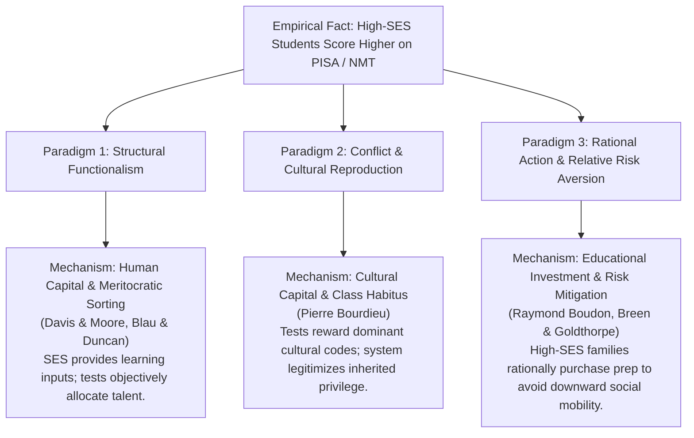

# Design Specification: Sociology Project #2 — Educational Stratification in Ukraine (PISA & Sociological Paradigms)

**Date:** 2026-09-30  
**Course:** KSE Sociology 2026/2027 (Dr. Tymofii Brik)  
**Topic:** Educational Inequality, Standardized Testing (NMT / PISA), and Competing Sociological Paradigms  
**Deliverable Language:** English  

---

## 1. Research Question & Empirical Puzzle
- **The Ukrainian Puzzle:** In Ukraine, why do some students achieve drastically higher scores on standardized national examinations (NMT / ZNO) and international assessments (PISA) than others?
- **Research Question (RQ):** To what extent does socio-economic background influence academic performance in Ukraine, and how do competing sociological paradigms interpret the underlying mechanisms of this relationship?

---

## 2. The Unified Empirical Hypothesis ($H$)
*Instructor constraint: "Always use the same data. H is the same, data is the same, paradigms are different."*

- **Formulation ($H$):**
  > **Primary Hypothesis ($H_1$):** Student socio-economic status (SES / ESCS) is a statistically significant, positive predictor of academic achievement in mathematics and reading in Ukraine, with this advantage being strongly compounded by institutional and spatial advantages (urban vs. rural/town schools).
  > 
  > **Decomposition Sub-Hypothesis ($H_2$):** When decomposing socio-economic status, parental educational attainment and cultural/academic resources at home exert a significantly stronger direct effect on test performance than pure household material wealth.

---

## 3. Theoretical Framework: Three Competing Sociological Paradigms

All three paradigms observe the exact same empirical regression gradient ($\beta_{SES} > 0$), but conceptualize the causal mechanism and societal role of the testing system in radically different ways:

### Paradigm 1: Structural Functionalism & Human Capital (Davis & Moore, Blau & Duncan, Parsons)
- **Ontology of Education:** The educational system is an efficient, meritocratic sorting mechanism required by modern differentiated societies to allocate individuals to occupational roles based on cognitive ability and effort.
- **Interpretation of Findings:** Standardized tests (PISA / NMT) are objective, universalistic assessments of cognitive competence. Higher-SES parents invest more resources into cognitive stimulation, tutoring, and stable learning environments, resulting in genuine human capital accumulation. The test score gap reflects legitimate differences in acquired skills necessary for functional societal performance.

### Paradigm 2: Conflict Theory & Cultural Reproduction (Pierre Bourdieu, Bowles & Gintis)
- **Ontology of Education:** The educational system is an instrument of cultural reproduction that legitimizes existing class structures while maintaining an illusion of neutrality and meritocracy.
- **Interpretation of Findings:** Standardized tests are epistemologically biased: they measure familiarity with the dominant class's cultural and linguistic codes (*cultural capital* and *habitus*), rather than raw intelligence. Educated parents transmit academic vocabulary, abstract reasoning, and test familiarity effortlessly at home. The school converts inherited social privilege into certified educational credentials, disguising social inequality as natural academic ability (*misrecognition* / *méconnaissance*).

### Paradigm 3: Rational Action Theory & Relative Risk Aversion (Raymond Boudon, Breen & Goldthorpe)
- **Ontology of Education:** Educational trajectories are the aggregate outcome of individual utility-maximizing choices made under structural budget constraints and subjective risk assessments.
- **Interpretation of Findings:** Stratification is driven by *primary effects* (cultural background influencing early academic ability) and *secondary effects* (rational educational decision-making). Families are governed by **relative risk aversion**—the fundamental desire to prevent downward social mobility. For high-SES families, falling below university entrance standards is catastrophic; therefore, they rationally allocate substantial household resources to shadow education (private tutoring, prep courses) to guarantee success. For disadvantaged rural families, alternative vocational or local pathways carry lower financial risk and opportunity costs, making intensive test-prep investments economically irrational.

---

## 4. Empirical Data & Modeling Strategy

### Data Sources (Exclusively PISA 2025)
1. **Official PISA 2025 Ukraine National Dataset & Reports (UCEQA / OECD, September 2026):**
   - Official national release from `https://testportal.gov.ua/zvity-dani-4/` (*Ofitsijnyj-zvit_PISA-2025.pdf*, *PISA-2025_Executive_Summary.pdf*, *PISA-2025_osnovni_rezultaty_UA.pdf*).
   - Sample: Representative cohort of 15-year-old Ukrainian students across 17 participating regions assessed in Science (major domain), Mathematics, Reading, and Computational Problem Solving / Learning in the Digital World.
   - National Means: Science = 448, Mathematics = 431, Reading = 418, Computational Problem Solving = 478.
   - Socio-Economic Gap: 66 score points in Science, 51 score points in Computational Thinking between top (Q4) and bottom (Q1) ESCS quartiles.
   - Spatial Gap: 61–68 score points difference between large cities and rural settlements (~3 full years of schooling).
   - Institutional Differentiation: Secondary schools (77.5%), Professional Pre-Higher Education PPHE (14.8%), Vocational VET (7.7%).

### Statistical Model Specifications (PISA 2025 Framework)
1. **Model 1 (Bivariate Socio-Economic Gradient):**
   $$Score_i = \beta_0 + \beta_1 ESCS_i + \epsilon_i$$
2. **Model 2 (Multivariate Spatial & Institutional Compounding):**
   $$Score_i = \beta_0 + \beta_1 ESCS_i + \beta_2 Urban_i + \beta_3 SchoolType_i + \epsilon_i$$
3. **Model 3 (Decomposition of Cultural Capital vs. Material Assets):**
   $$Score_i = \beta_0 + \beta_1 ParentalEducation_i + \beta_2 DigitalResources_i + \beta_3 MaterialWealth_i + \beta_4 Urban_i + \epsilon_i$$

---

## 5. Subagent Verification Protocol
Before finalizing results, an independent **Verification Subagent** will be dispatched to verify:
1. **Statistical Accuracy:** Confirm regression coefficients, standard errors, $R^2$, and $F$-tests against raw data.
2. **Literature & Theory Fidelity:** Ensure Bourdieu, Davis-Moore, and Breen-Goldthorpe concepts are strictly and accurately applied without sociological misattribution.
3. **Absence of Hallucination:** Ensure no numbers or sources are fabricated (complying with Dr. Brik's rubric in `REPORT.docx`).

---

## 6. Deliverable Artifacts
1. `ukr_pisa_analysis.py` (Reproducible Python execution script generating models and figures)
2. `ukr_pisa_analysis.R` (Full, parallel R script using `tidyverse` / `ggplot2` for RStudio)
3. `figure1_ses_gradient.png`, `figure2_capital_decomposition.png`, `figure3_spatial_gap.png`
4. `SOCIOLOGY_PROJECT_2_REPORT.md` (Comprehensive English research report containing empirical study and discussion)
5. `ONE_PAGER_DATA_REQUIREMENTS.md` (Task 2: Detailed 1-pager outlining ideal data required to empirically distinguish each paradigm)
6. `prompts_log.md` (Verbatim record of all prompts and analytical steps)
7. Final **AI-Use Log** (compiled only when explicitly commanded by the user).
